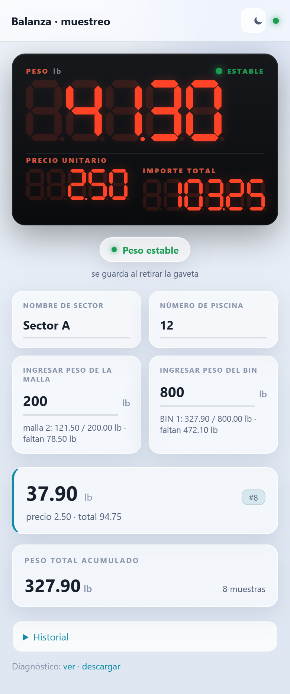
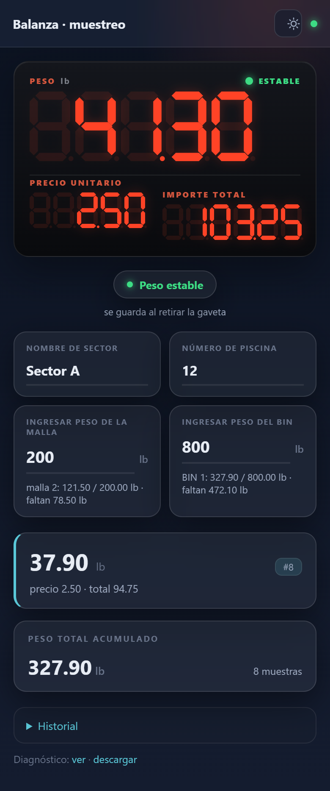
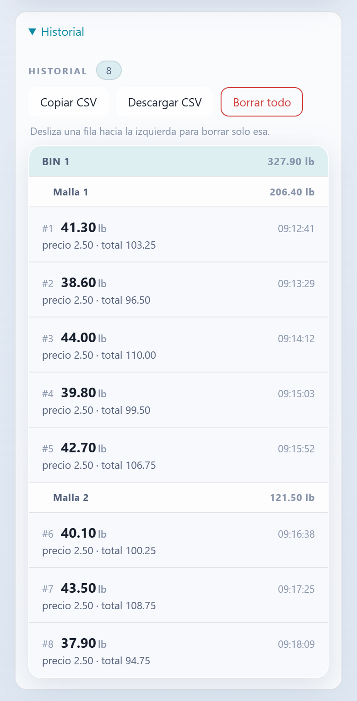
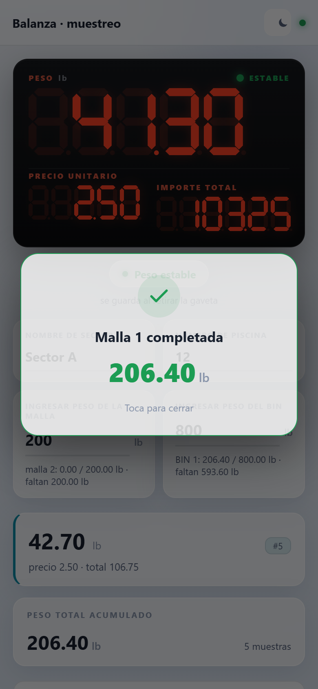
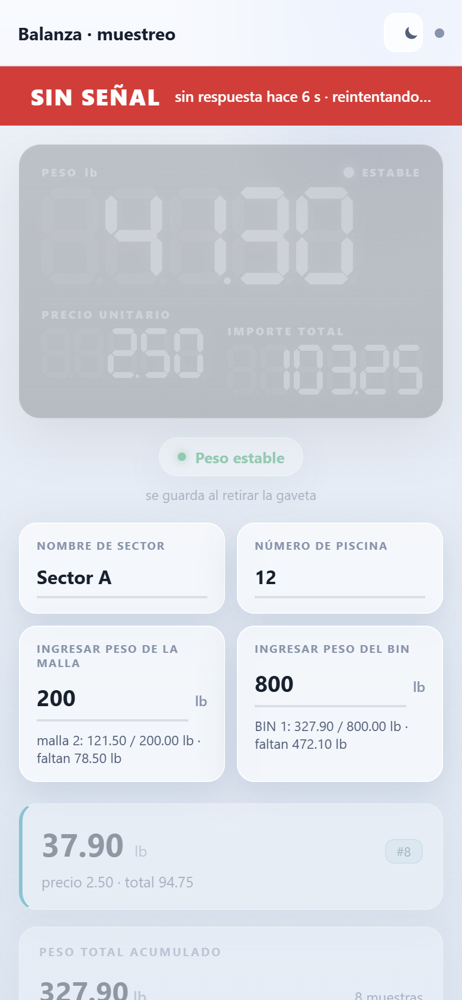
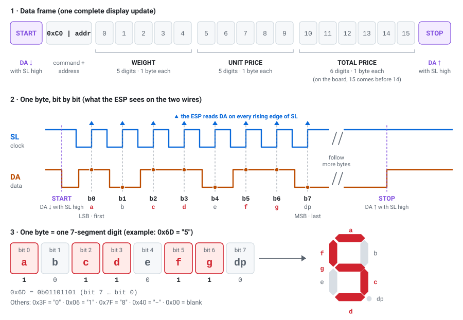

# Automatic sampling scale reader

Automatically read the value shown by a **price-computing scale** (`ACS-JC36CV28` main board +
`WP-91110-2540-V7` display board, `CS2540` chip) and send it to a sampling system.

## Web panel

The ESP creates its own WiFi network and serves a mobile-first panel, with no internet or apps
needed: a replica of the scale's LED display, history grouped by BIN and mesh, CSV export,
light/dark mode and status alerts. The panel's user interface is in Spanish.

<table>
  <tr>
    <td align="center"> Light mode</td>
    <td align="center"> Dark mode</td>
    <td align="center"> History by BIN and mesh</td>
  </tr>
  <tr>
    <td align="center"> Alert when a mesh is completed</td>
    <td align="center"> "SIN SEÑAL" (no signal) alert</td>
    <td></td>
  </tr>
</table>

Screenshots with sample data: the real panel fed by a simulated ESP, not real measurements.

## Chosen approach: tap the display bus

Over **2 wires** (`DA` = data, `SL` = clock), the main board sends the display board the content
of the 3 displays (WEIGHT 5 digits, PRICE 5, TOTAL 6 = **16 digits**).
The `CS2540` chip is equivalent to a **TM1640**.

Listening to those 2 lines **passively** gives the exact value the scale shows, without touching
the measuring circuit and without the lighting/OCR problems of a camera.

No logic analyzer is needed: an **ESP32 / ESP32-S3** acts as the sniffer.

## Sketches

| Folder | Board | What it does |
|---|---|---|
| [`sniffer_tm1640/`](sniffer_tm1640/) | any ESP32/ESP32-S3 (Heltec V3) | sniffer only; dumps the display RAM over USB serial. Used to reverse-engineer the protocol. |
| [`peso_balanza_cam/`](peso_balanza_cam/) | **ESP32-S3 Super Mini** | **Final firmware**: bus sniffer + weighing history with meshes/BIN + web panel over WiFi. |

> Sniffer on **GPIO1 (SL) / GPIO4 (DA)**, with a **Schottky diode** in series on DA in addition
> to the 470 Ω resistor. Arduino IDE: "ESP32S3 Dev Module", 4 MB flash, PSRAM `Disabled`,
> **USB CDC On Boot `Enabled`** (the board has no CH340).
> See [`peso_balanza_cam/README.md`](peso_balanza_cam/README.md) (in Spanish).

## Phase 1 — Reverse-engineering the protocol (`sniffer_tm1640/` sketch)

### How it is tapped and decoded

The scale's numbers are **7-segment LEDs**. The main board does not send the display the number
"41.30", but **which segments to light in each digit**, over a 2-wire bus understood by the
`CS2540` chip (TM1640 family):

- `SL` = clock: each bit is valid on the **rising edge** of `SL`. `DA` = data: 8 bits per byte,
  **least significant bit first**.
- **START** = `DA` falls while `SL` is high · **STOP** = `DA` rises while `SL` is high (like I²C,
  but without ACK).
- The frame that matters starts with `0xC0 | address` and continues with **1 byte per digit** (16 in
  total: the display "RAM"). Mode (`0x40`) and brightness (`0x80…0x8F`) commands are ignored.

One display update at a glance (the ESP only listens, it never sends anything):

  <picture>
    <source media="(prefers-color-scheme: dark)" srcset="docs/trama-oscuro.svg">
    
  </picture>

**Tapping = listening without touching.** `SL` and `DA` go into two ESP32 pins (with 470 Ω in
series, a Schottky diode on `DA` and a common GND) and the ESP **never writes to the bus**. Two
interrupts do all the work:

1. **Rising edge of `SL`** → read `DA` and build the byte bit by bit.
2. **`DA` change while `SL` is high** → START (a frame begins) or STOP (it ends, and its bytes are
   copied to a 16-byte mirror RAM).

The bus clock is about 140 kHz, so a normal ESP32-S3 interrupt keeps up without special hardware.
The copy is read once the bus has been quiet for a few milliseconds, so a half-finished refresh
is never read.

**Decoding = turning those 16 bytes into numbers:**

| Bytes | Field | Digits |
|---|---|---|
| 0–4 | WEIGHT | 5 |
| 5–9 | UNIT PRICE | 5 |
| 10–15 | TOTAL PRICE | 6 (on the board the last two are swapped: 15 comes before 14) |

- **Byte → digit:** bits 0–6 are segments `a`–`g` and bit 7 is the decimal point. A 7-segment
  table translates it (`0x3F` = "0", `0x06` = "1", `0x7F` = "8"…), including "blank" and the
  "−" sign (segment `g` only).
- **Digits → value:** the digits are joined right-aligned within the field and the decimal point
  is placed (WEIGHT and TOTAL: 2 fixed decimals; PRICE: wherever the scale lights the point, or an
  integer).
- **Robustness:** an icon (NET/TARE…) overlapping a digit is tolerated (1 segment of difference),
  and for what the panel shows, a refresh corrupted by noise is discarded because it differs from
  its neighbours. "Stable" is not on the bus: the ESP computes it when the weight has been the
  same for 4 refreshes in a row.

Which byte is which digit and which bit is which segment is exactly what the procedure below
finds out; on this scale it turned out to be the standard mapping (`a` = bit 0 … `g` = bit 6,
point = bit 7).

### Wiring (3 wires)

| Scale (DIS connector) | → | ESP32 |
|---|---|---|
| `DA`  | `[470 Ω]` | GPIO `PIN_DA` (default 4) |
| `SL`  | `[470 Ω]` | GPIO `PIN_SL` (default 5) |
| `GND` | — | `GND` (common ground, **required**) |

- Do **NOT** connect `VCC_DIS`.
- 3 V logic → goes straight into the ESP32-S3 GPIO, no level shifter needed.
- Recommended: a **Schottky diode** (BAT54 / 1N5817) in series on `DA`, anode toward the scale
  (see `peso_balanza_cam/README.md`, section 2).
- During the test: scale on **its own battery** (not the mains charger), ESP32 over USB.
- Set `PIN_DA` / `PIN_SL` in the `.ino` to two free GPIOs of your board (range 0–31).

### Procedure

1. Flash `sniffer_tm1640.ino`. Open the Serial Monitor at **115200**.
2. **Turn on the scale** → the segment self-test is captured (all segments on).
3. Enter **known** values and write down what each display shows at each moment:
   - empty and at zero
   - reference weight (e.g. 500 g) → `0.500`
   - another weight → `1.234`
   - price on the keypad: `1.00`, `9.99`, `12.50`
   - unstable vs stable platform (STABLE icon)
   - tare / zero
4. Copy the **whole** log and analyze it to deduce:
   - which byte (`D00`–`D15`) corresponds to which physical digit of which display
   - which bit of each byte is which segment (a–g) and which is the decimal point
   - which leftover bits are icons (`kg`/`lb`, STABLE, ZERO, TARE, NET, battery…)

Serial Monitor commands: `d` normal · `c` raw transactions · `f` statistics ·
`r` raw edge dump (only if decoding comes out as garbage).

## Phase 2 — Final firmware (done: `peso_balanza_cam/`)

With the map from Phase 1, the firmware:
- Listens passively → rebuilds the 16 bytes on every refresh.
- Applies the map → WEIGHT, PRICE, TOTAL, decimal points, and works out whether the weight is
  stable.
- Detects when a tray is removed and saves **one weighing** (it tells a tare from a real
  removal); all weighings are kept (they survive power cuts) until *Borrar todo* (clear all) is
  pressed: the last 120 in NVS and the full history in a file in flash (LittleFS).
- Captures the value with a **tolerant window** (it accepts the weight even if the product drips
  or the load cell bounces, and never saves a value from the drop to zero when the tray is
  removed).
- Keeps a **diagnostic log** in RAM (`/log`, downloadable from the phone): weighings saved/lost
  and why, WiFi connections and signal, reboots, program stalls.
- The panel shows a red **"SIN SEÑAL"** (no signal) bar when it stops receiving data from the
  ESP.
- Groups the weighings into **meshes and BINs** with targets typed in by the operator, and shows
  a pop-up when a group is closed.
- Publishes everything over WiFi on a **web panel** (the board creates its own network) and
  exports CSV.

Pending: sending to an external server (MQTT / HTTP). There is a ready hook, `weighOnCommit()`,
that fires once for every confirmed weighing.

### Assembly

The scale's metal housing blocks WiFi: the ESP32-S3 goes in an **external plastic box**, powered
from the scale's battery through a buck-boost converter (TPS63020) at 3.3 V. Two 5 V fans, each
switched by a 2N2222, cool the box according to the chip temperature. Full wiring diagram of the
box:

  <picture>
    <source media="(prefers-color-scheme: dark)" srcset="docs/esquema-caja-oscuro.svg">
    
  </picture>

Details (materials, polarities, transistor calculation) are in the *Alimentación y montaje* and
*Ventilación de la caja* sections of `peso_balanza_cam/README.md` (in Spanish).

### Printed circuit board

The box circuit is also designed as a 2-layer through-hole PCB (KiCad 10, generated by script,
with ERC, DRC and schematic-to-PCB parity at zero). There are three versions in
[`hardware/pcb/`](hardware/pcb/):

| Version | Size | What changes |
|---|---|---|
| [v1](hardware/pcb/) | 70 × 50 mm | TPS63020 module off-board, connected through a 4-way terminal block |
| [v2](hardware/pcb/v2/) | 96 × 53 mm | All terminal blocks in one row on one edge; TPS63020 module mounted on the board |
| [v3](hardware/pcb/v3/) | 70 × 50 mm | v1 with the TPS63020 module mounted on the board |

## If the interrupt-based sniffer loses bits

Symptoms: the 16 bytes are inconsistent between refreshes, or the self-test does not give
`0xFF` in all of them.

Options, in order:
1. Use the `r` command and send the raw edge dump → it is decoded offline.
2. Version with hardware capture (the ESP32-S3 **I2S / LCD_CAM** peripheral, `SL` as clock,
   `DA` as data, via DMA) — immune to the bus speed.
3. Raspberry Pi Pico (~€4) as a logic analyzer with sigrok firmware (*pico logic analyzer*
   project), easier to get than a Saleae.

## Last resort: camera + OCR

Reading the display with a camera (classic 7-segment recognition) was tried before moving to the
sniffer, and was dropped: the sniffer gives the **exact** value straight from the bus, without
depending on light or framing, so it is the only method left in `peso_balanza_cam/`. If the camera
approach were ever needed again, it is in the git history (commits before the 2026-10-01
cleanup). If the bus cannot be tapped on a different scale, the idea would still be valid: an
ESP32-CAM fixed in front of the display, locked exposure, a ROI crop per digit, validation over
several frames (and, if the digits confuse 3/5/6/8/9, a trained CNN instead of segment decoding).

## License

Code published **for reference and as a work sample (portfolio) only**. All rights reserved: it
may not be copied, modified, redistributed, sold or used in other projects without written
permission. Details in [`LICENSE`](LICENSE).
