# peso_balanza_cam — ESP32-S3: sniffer del bus de la balanza + panel web

Lee **PESO, PRECIO y TOTAL** de la balanza cuenta-precio **escuchando de forma pasiva
el bus del display** (sniffer), guarda cada pesaje, los agrupa en **mallas y BIN** con
alertas para el operario, y lo publica por WiFi en un **panel web** (la propia placa
crea la red; no hace falta router ni internet).

Se probó también leer el display con una cámara (OCR de 7 segmentos) antes de llegar a
este diseño; se descartó porque el sniffer da el valor **exacto** directo del bus, sin
depender de luz ni encuadre. Si hiciera falta recuperarlo, está en el historial de git
(commits anteriores a la limpieza de 2026-10-01).

Placa: **ESP32-S3 Super Mini** (chip ESP32-S3FH4R2: 4 MB flash + 2 MB PSRAM Quad,
un solo USB-C nativo, sin CH340). Antes se usaba un ESP32-S3-WROOM (N16R8) con
conector FFC de cámara y doble USB-C; se cambió de módulo por daño de hardware
(ver la sección 2, pines del sniffer).

---

## 1. Interruptor general — `config.h`

```c
#define ENABLE_SNIFFER   1     // escuchar el bus DA/SL del display
```

Apagarlo (**0**) no compila nada del sniffer (ni reserva pines ni RAM); solo sirve
para probar el panel web sin la balanza conectada. No hay otro método de lectura.

---

## 2. Compilar (Arduino IDE)

- esp32 (Espressif) ≥ 3.0 · Placa: **ESP32S3 Dev Module** (genérico, sirve para el Super Mini)
- **PSRAM: `Disabled`** (nada en este firmware la necesita)
- Flash Size: `4MB (32Mb)` · Partition: uno pensado para 4MB **que incluya SPIFFS**. Esa
  partición es donde se guarda el **historial completo** de pesajes (ver sección 3); sin ella
  el programa funciona igual, pero solo conserva los últimos 120 pesajes. El binario ocupa
  ~1,1 MB y no se usa OTA, así que cualquiera de estos sirve; la diferencia es cuántos
  pesajes caben (unos 24 bytes cada uno, usando el 75 % de la partición):

  | Esquema | SPIFFS | Pesajes |
  |---|---|---|
  | `Minimal SPIFFS (1.9MB APP with OTA/128KB SPIFFS)` | 128 KB | ~4 000 |
  | `Huge APP (3MB No OTA/1MB SPIFFS)` | 896 KB | ~28 000 |
  | `No OTA (2MB APP/2MB SPIFFS)` *(recomendado)* | 1,9 MB | ~61 000 |

  La primera vez que arranca con una partición nueva (vacía) la formatea (unos segundos,
  más cuanto más grande sea) antes de levantar el WiFi. Una partición **con datos** que no
  monta no se formatea nunca: el panel avisa "sin memoria permanente", `/log` lo anota y se
  sigue solo con el buffer de los últimos pesajes.
- USB CDC On Boot: **`Enabled`** — esta placa NO tiene CH340, es un solo
  USB-C nativo; con `Disabled` no sale nada por el Monitor Serie
- Monitor Serie **115200** → sale la IP / la red creada.
- Si el puerto COM aparece y desaparece al conectar (típico de una placa nueva con el
  firmware de fábrica), **mantén presionado BOOT mientras conectas el USB**, suéltalo a
  los 2-3 s y sube el sketch; después ya arranca estable.

### WiFi — `config.h`

```c
#define WIFI_MODE  0     // 0 = SOLO AP (campo) · 1 = SOLO router · 2 = AP + router
```

| Modo | Qué hace |
|:---:|---|
| **0** *(actual)* | El ESP **crea su red** `WIFI_AP_SSID` / `WIFI_AP_PASS`. Panel en **`http://192.168.4.1/`**. Para campo, sin router. |
| 1 | Se une al router (`WIFI_SSID`/`WIFI_PASS`). Si no puede en 15 s y `WIFI_AP_FALLBACK 1`, crea su red. |
| 2 | Las dos: su red **siempre**, y además se une al router si lo ve (sin bloquear). Sirve para oficina. |

**Portal cautivo** (`WIFI_CAPTIVE`, **en `0` en prueba desde 2026-10-07**): con `1`, al
conectar el móvil a la red del ESP el sistema operativo abre solo el panel (como el login
de un aeropuerto). Lo hace un DNS "atrápalo-todo" en el ESP + un redirect a `192.168.4.1`
para cualquier URL desconocida. Contra: ese DNS también trae al ESP el tráfico de fondo de
las apps de los celulares (más carga para su servidor web de un solo hilo). Con `0` no hay
DNS: el panel se abre a mano en `http://192.168.4.1/` o con el acceso directo de abajo.

**Acceso directo "Balanza" en la pantalla de inicio.** Con el celular conectado a la red del
ESP, abre `http://192.168.4.1/` y: **Android (Chrome)** menú ⋮ → *Añadir a pantalla de inicio*;
**iPhone (Safari)** Compartir → *Agregar a inicio*. Queda un icono "Balanza" (lo sirve el ESP:
`/icon.png`, `/manifest.json`). En iPhone se abre a pantalla completa como una app; en Android
abre una pestaña de Chrome (una app "instalada" de verdad exigiría HTTPS). Si el celular no
está en la red de la balanza, el icono muestra un error: conéctate primero (deja activado
*conectar automáticamente* en esa red).

Sin internet no hay NTP: el **móvil del operario pone la hora** al abrir el panel
(`/settime`), así el historial lleva hora real. Si tampoco, queda solo el orden.

**Recuperación automática del AP** (modos 0 y 2): si el driver de WiFi detiene la red
propia (evento `AP_STOP`, o el modo deja de ser AP), el firmware la vuelve a levantar
solo. Ignora los avisos de los primeros 5 s tras levantarla (`AP_GRACE_MS`), que son
ruido del arranque. El contador `APrec` del latido por Serial cuenta las recuperaciones
reales: en funcionamiento normal debe quedar en **0**.

### Pines del sniffer (solo si `ENABLE_SNIFFER 1`)

| Balanza | | ESP32-S3 |
|---|---|---|
| `SL` | `— [470 Ω] —` | `GPIO1` |
| `DA` | `— [470 Ω] — [diodo Schottky] —` | `GPIO4` |
| `GND` | `———` | `GND` (masa común **obligatoria**) |

DA lleva además un **diodo Schottky** en serie (BAT54 / 1N5817 / 1N5819; ánodo hacia la
balanza, cátodo hacia el GPIO) — protege contra una fuga interna del ESP devolviéndose
hacia el bus de la balanza (así se descubrió que el módulo WROOM anterior tenía 2 GPIO
con fuga hacia el riel de 5V, y terminó reemplazándose). Usa Schottky y no un diodo de
silicio: la lógica es de ~3 V y los 0,6 V de un 1N4148 dejarían el nivel alto demasiado
justo.

No conectar `VCC_DIS`. `GPIO1` y `GPIO4` están limpios en esta placa; **no
`GPIO2`** (tiene el LED "ON" de la placa, que carga la línea). Evitar UART0
(`43/44`), USB nativo (`19/20`) y strapping S3 (`0/3/45/46`) — son del silicio,
valen para cualquier placa. El ISR lee `GPIO_IN_REG` → usa pines ≤ 31.

### Alimentación y montaje

- **La carcasa metálica de la balanza bloquea el WiFi** (jaula de Faraday): con la
  placa dentro y la tapa cerrada la red no aparece. El ESP32-S3 va en una **caja de
  plástico externa**, con solo los 3 cables del sniffer más la alimentación.
- Alimentación desde la **batería de la propia balanza** (una celda de Li-ion, ~4,1–4,2 V
  a plena carga): un convertidor **buck-boost TPS63020** (no un buck simple, porque la
  celda baja por debajo de 3,3 V al descargarse) ajustado a **3,3 V** y conectado al pin
  **`3V3`** de la placa (no al `5V`). Su entrada admite como máximo 5,5 V: mide la
  batería una vez con el cargador de la balanza enchufado.
- **Cuidado con descargar la celda en exceso**: el TPS63020 sigue funcionando hasta
  ~1,8 V, y la celda se daña por debajo de ~3,0 V. Si la placa se queda conectada con la
  balanza apagada, sigue consumiendo. Toma la alimentación **después del interruptor
  de la balanza** o pon un interruptor propio, y apágalo al terminar.
- **No enchufes el USB con la batería conectada** (dos fuentes en el `3V3`): apaga la
  alimentación antes de flashear o conectar al PC.
- **No conectes nada a `BATTERY+` / `BATTERY-`** de la Super Mini: tiene su propio
  cargador de batería y no debe pelearse con el de la balanza.
- Recomendado un condensador de salida (electrolítico 220–470 µF + cerámico 100 nF) lo
  más cerca posible del pin `3V3`: los picos de corriente del WiFi (~0,4–0,5 A) son más
  rápidos de lo que responde el regulador.
- Consumo de referencia con el WiFi siempre activo (el firmware no duerme): ~150–250 mA
  de media → la autonomía en horas ≈ mAh de la batería ÷ mA. Es una estimación, no una
  medición; conviene medirla en la placa real.

### Ventilación de la caja (`FAN_ENABLE`)

Dos ventiladores pequeños que trabajan **juntos**: uno mete aire en la caja de plástico y el
otro lo saca. Se encienden y apagan a la vez según la **temperatura interna del chip** (la
misma `t=` de `/log`), con histéresis: **ON al llegar a `FAN_ON_C` (68 °C)**, **OFF al bajar a
`FAN_OFF_C` (60 °C)**, usando la media de ~30 s (el sensor tiene ±2–3 °C de ruido) y al menos
`FAN_MIN_ON_MS` (60 s) encendidos. Si el sensor no da dato, se encienden (a prueba de fallos).
Lo controla `loop()` cada `FAN_CHECK_MS`, nunca la tarea del pesaje. Referencias: 59 °C en la
oficina, 69–70 °C al aire libre (2026-10-07).

#### Conexión

Esquema completo de la caja (alimentación, Super Mini con sus pines en posición real, los
dos canales de ventilador y el sniffer):

<p align="center">
  <picture>
    <source media="(prefers-color-scheme: dark)" srcset="../docs/esquema-caja-oscuro.svg">
    
  </picture>
</p>

Los ventiladores tienen su **propia rama** desde la batería, antes del TPS63020, y su
retorno (`GND_P`) va en cable propio directo al borne − (masa en estrella). Cada canal se
monta dos veces: canal 1 = GPIO5, Q1, D1, C5, R1, R2; canal 2 = GPIO6, Q2, D2, C6, R3, R4.

```
 +V VENT ────────●──────────────────●──────────────────●
                 │ cátodo (banda)   │ rojo             │
            D1  ─┴─               FAN1 (+)            ─┴─
          1N5819 ▲                ( M )               ─┬─  C5  100 nF cerámico
                 │ ánodo          FAN1 (−)             │       (en los bornes del ventilador)
                 │                  │ negro            │
                 ●──────────────────●──────────────────●
                                    │
                                    │ C (colector)
 GPIO5 ──[R1 470 Ω]──●──────── B ──┤  Q1  2N2222 (NPN)
                     │              │ E (emisor)
                 [R2 10 kΩ]         │
                     │              │
 GND ════════════════●     BAT− ════●═══════  (GND_P: cable directo al borne −)
```

Polaridades y patas (donde suelen estar los errores):
- **D1/D2**: la banda (cátodo) va a +V VENT. Al revés, cortocircuita la rama.
- **C4**: la pata larga (+) va a +V VENT y la franja (−) a BAT−.
- **2N2222 en TO-92**: casi todos son **E-B-C** (cara plana al frente, patas abajo), pero
  algunos (P2N2222A) son **C-B-E**. Compruébalo con el multímetro en modo diodo: la base
  es la pata que marca ~0,6–0,7 V hacia las otras dos (punta roja en la base); base-emisor
  marca unos milivoltios más que base-colector.
- **Ventiladores de 4 cables**: rojo (+) a +V VENT y negro (−) al colector. El amarillo
  (tacómetro) y el azul (PWM) **no se usan**: córtalos cortos y aísla cada uno con
  termorretráctil. Sin señal en el azul, el ventilador gira a velocidad máxima.
- En la Super Mini, `GPIO5` y `GPIO6` están en la tira izquierda (pines "5" y "6", entre
  el 4 y el 7). `GND` está en la tira derecha, segundo desde arriba.

#### Materiales

| Ref. | Valor | Tipo | Cant. | Función |
|---|---|---|---|---|
| R1, R3 | 470 Ω ¼ W 5 % | película | 2 | Base: ~5 mA, satura el transistor sin cargar el GPIO |
| R2, R4 | 10 kΩ ¼ W 5 % | película | 2 | Transistor apagado al arrancar y al flashear |
| Q1, Q2 | 2N2222 / PN2222A (NPN, 40 V, 0,6 A) | TO-92 | 2 | Interruptor del ventilador por el negativo |
| D1, D2 | 1N5819 (1 A, 40 V Schottky) | DO-41 (SMD: SS14) | 2 | Absorbe el pico al apagar el motor |
| C5, C6 | 100 nF 50 V X7R ("104") | cerámico | 2 | Ruido de la electrónica del ventilador |
| C4 | 470 µF 16 V, 105 °C | electrolítico radial | 1 | Reserva local para el arranque de los motores |
| C7 | 100 nF 50 V X7R | cerámico | 1 | Desacople en alta frecuencia, junto a C4 |
| F1 | fusible 1 A lento (5×20) o PTC 1,1 A (MF-R110) | portafusible | 1 | Protege toda la instalación |
| F2 | PTC 0,75 A (MF-R075) | radial | 1 | Un ventilador en corto corta solo su rama |
| FAN1, FAN2 | 5 V, 0,16 A, 30×30 mm, 4 cables | — | 2 | Uno mete aire en la caja y otro lo saca |

Cálculo de la base: (3,3 V − ~0,9 V) / 470 Ω ≈ 4,8 mA para ~0,13–0,16 A de ventilador
(β forzada ≈ 27–33). La corriente de base sale del GPIO, alimentado por los 3,3 V fijos del
TPS63020, mientras que la del ventilador baja con la batería: el caso más exigente es con
la celda llena. Para comprobarlo, con los ventiladores girando la tensión colector-emisor
debe quedar por debajo de ~0,4 V; si no, baja R1/R3 a 220–330 Ω (o pon otra de 470 Ω en
paralelo). Con un MOSFET de nivel lógico (AO3400A, Si2302) en su lugar: 100 Ω en la puerta
y 100 kΩ a masa. **No uses IRF520/IRFZ44N** (sin la "L"): con 3,3 V apenas conducen.

#### Montaje

- **Nunca** el ventilador directo al GPIO (da ~40 mA; un ventilador pide 60–200 mA).
- **+V VENT sale de la batería**, no del TPS63020 ni del pin `3V3`: el arranque del motor
  podría hundir los 3,3 V y reiniciar el ESP.
- **El retorno va en su propio cable**: los emisores de Q1/Q2 van directo al borne − de la
  batería (`GND_P`), para que la corriente de los motores no pase por la masa del ESP ni del
  sniffer.
- **Q1/Q2, R1–R4 y D1/D2 cerca de la ESP**. **C5/C6 en los bornes de cada
  ventilador. C4/C7 al final de +V VENT**, junto a los ventiladores.
- **Cables de los ventiladores en par trenzado**, lejos de `DA`/`SL`: `GPIO5` está pegado
  a `GPIO4` (DA) en la tira de pines.
- **Ventiladores de 5 V**: con la celda a 3,6–4,1 V giran a ~70–80 %. Comprueba que
  **arrancan solos desde parados con 3,5 V**; si no, usa ventiladores de 3,3–3,7 V o un
  elevador a 5 V solo para esta rama. Uno de 12 V no arranca.
- El estado sale en `/api` (`"fan":true`, `"tchip"`), en el latido del Monitor Serie
  (`vent:1 t:61`), en `/log` como `VENT ON t=61` / `VENT OFF t=60` y en la cabecera de `/log`
  (minutos encendidos). `FAN_ENABLE 0` lo desactiva.

---

## 3. Cuándo se guarda un pesaje — máquina de estados

`weighlog.cpp`. Regla simple (desde 2026-10-07):

```
 VACÍA ──(peso ≥ WEIGH_MIN_LOAD, 12 lb)──▶ CON CARGA
 CON CARGA: se busca el valor ESTABLE (ventana tolerante) y se recuerda el MÁXIMO
   └─ el peso pasa por CERO o queda NEGATIVO (≤ WEIGH_ZERO_THRESH) ──▶ se cierra la gaveta:
        1. hubo valor estable ≥ 12 lb ─────────────▶ se GUARDA ese valor     ('r' en /log)
        2. no lo hubo ─────────────▶ se GUARDA el valor donde estuvo QUIETA más tiempo ('e … sost')
        (los dos solo si la gaveta estuvo puesta ≥ WEIGH_MIN_MS, 600 ms; si no → PERDIDO)
 Lecturas > WEIGH_MAX_LOAD (80 lb) se ignoran (prueba de display "888.8", presión muy fuerte).
```

- **Menos de 12 lb es tara o nada**: una gaveta siempre pesa más. Mover o tocar la balanza,
  re-tarar con la gaveta vacía o el ruido alrededor de cero nunca abren un pesaje, y nunca
  se guarda un valor (estable ni estimado) por debajo de 12 lb.
- **Una gaveta por paso por cero**: si se cambia una gaveta por otra sin que el peso llegue a
  cero, cuentan como una sola (se guarda la primera). En la práctica siempre se quita antes
  de poner la siguiente.
- **No se distingue "retiro" de "tara"**: en campo nunca se presiona TARA con una gaveta
  llena, así que cualquier gaveta que pasa por cero (con tara activa la plataforma vacía marca
  negativo, p. ej. −9) se guarda, aunque se haya quitado de golpe.
- **Una presión de la mano antes de quitar la gaveta no sube el valor**: si hubo valor estable
  (quieto ≥ 0,4 s en total) se guarda ese; si no, el valor donde la lectura estuvo quieta más tiempo (la presión
  es un pico corto). Probado con la balanza real el 2026-10-07: antes guardaba 40-60 lb para una
  gaveta de ~23 lb.
- **Más de 80 lb se ignora** (`WEIGH_MAX_LOAD`): la prueba de display de la balanza al encenderse
  ("888.8") se guardaba como pesaje. Las gavetas más pesadas vistas pesan ~60 lb.
- **Nunca se guarda un pesaje sin valor**: si no hay valor estable ni máximo válido, la gaveta
  queda como `PERDIDO` en `/log`.
- **600 ms mínimos**: un golpe o apoyo corto de la mano sobre la plataforma no es una gaveta.
  Una mano apoyada con ≥ 12 lb durante más de 0,6 s sí se guardaría (no se distingue de una
  gaveta muy rápida).
- Desde la versión con el estado de NVS agrupado (`"st"`), el primer arranque convierte lo
  guardado al formato nuevo y borra las claves anteriores: **no vuelvas a cargar un firmware
  anterior**, porque arrancaría con el buffer y los acumulados vacíos (el archivo LittleFS
  sí se conserva).
- Display ilegible, por encima de 80 lb o **congelado** (sin refrescos nuevos durante
  `WEIGH_FRAME_TIMEOUT_MS`) durante `WEIGH_INVALID_MS` con una gaveta puesta: se cierra y se
  guarda el **último valor estable** visto (si no lo hubo, el estimado, como siempre). `/log`
  anota `DISPLAY sin datos …`. Después no se acepta otra gaveta hasta ver el peso en cero
  (la misma gaveta podría seguir encima cuando vuelva el display).
- El punto verde del panel lo calcula el sniffer (el PESO lleva `SNIF_STABLE_N` = 4 refrescos
  seguidos igual; no viene en el bus): es solo visual y no decide qué valor se guarda.
- **PRECIO y TOTAL** se toman con el valor estable (o el último precio visto, para el estimado).
- Monitor Serie: `[pesaje] carga detectada...` · `[pesaje] estable -> GUARDADO PESO 41.30 ...` ·
  `[pesaje] ESTIMADO -> GUARDADO ...`.

Ajustes en `config.h` (los números son **absolutos, en la unidad de la balanza**: el
firmware no convierte nada, así que la balanza debe estar en **libras**):

| Parámetro | Qué es | Por defecto |
|---|---|---|
| `WEIGH_ZERO_THRESH` | por debajo (o igual) durante 3 **refrescos nuevos** seguidos del display (~165 ms, `WEIGH_ZERO_N`) = la gaveta pasó por cero → se cierra; un refresco suelto de 0 no cierra | `0.06` |
| `WEIGH_MIN_LOAD` | una gaveta empieza al llegar a este peso; menos = tara / nada | `12` |
| `WEIGH_MAX_LOAD` | lecturas por encima se ignoran (como display ilegible): prueba de display, presión fuerte | `80` |
| `WEIGH_MIN_MS` | tiempo mínimo puesta para guardarse (un golpe de la mano no es gaveta) | `600` |
| `WEIGH_INVALID_MS` | display ilegible o congelado este tiempo con gaveta puesta → se cierra y se guarda el último estable (o el estimado) | `2500` |
| `WEIGH_FRAME_TIMEOUT_MS` | sin un refresco nuevo del display en este tiempo = display congelado | `1000` |
| `WEIGH_LOG_SIZE` | pesajes recientes que guarda en el buffer de memoria/NVS | `120` |
| `WEIGH_ARCHIVE` | `1` = además del buffer, guarda **todos** los pesajes en un archivo en flash hasta *Borrar todo*; `0` = solo el buffer | `1` |
| `WEIGH_FEED_MS` | cada cuánto se alimenta la máquina de estados | `20` |
| `WEIGH_WIN_MS` | ventana en la que las lecturas deben variar poco para dar un valor por asentado | `250` |
| `WEIGH_BAND` | cuánto puede variar el peso dentro de esa ventana (el escurrido, ~0,1 lb/s, cabe de sobra) | `0.15` |
| `WEIGH_TOL_ABS` / `WEIGH_TOL_PCT` | tras el primer valor asentado solo se aceptan otros a menos de `max(TOL_ABS, TOL_PCT %)` de él | `1.0` / `3.0` |
| `WEIGH_PLACE_MS` | durante este tiempo desde que empieza la gaveta, la referencia todavía puede SUBIR (gaveta posada despacio) | `1000` |
| `WEIGH_PLAUS_FRAC` / `WEIGH_PLAUS_HOLD_MS` | caso "pausa a mitad de colocación": un estable que estuvo quieto en total < 400 ms y después el peso subió por encima de `valor / 0,7` se descarta | `0.7` / `400` |
| `WEIGH_RESCUE_FRAC` | en ese caso de pausa (o si la lectura nunca estuvo quieta) se guarda este factor × el máximo | `0.92` |
| `DIAG_LOG` | `1` = registro de diagnóstico `/log` (ver sección 8); `0` = desactivado | `1` |
| `DIAG_LOG_LINES` | líneas que conserva `/log` en RAM (64 bytes cada una); ~4 líneas/min en una jornada real → 256 alcanzan para ~1 h | `256` |

**Valor estable: captura por ventana tolerante.**

1. Un valor se da por **asentado** si las lecturas de los últimos `WEIGH_WIN_MS` (250 ms)
   varían menos de `WEIGH_BAND` (0,15 lb) — con al menos 5 lecturas y la ventana completa.
2. El **primer valor asentado de ESA gaveta** es su referencia (se borra con cada gaveta).
   A partir de ahí solo se aceptan valores asentados a menos de `max(1 lb, 3 %)` de ella.
3. **Nunca se guarda un valor de la caída a cero**: esa bajada recorre decenas de lb en
   fracciones de segundo, ni forma un tramo asentado ni entra en la banda de la referencia.
4. Solo durante el primer `WEIGH_PLACE_MS` la referencia puede **subir** (gaveta posada despacio).
5. El valor guardado es el **último** asentado dentro de la banda (el escurrido se refleja
   como una bajada de décimas).

**Pausa a mitad de colocación (`WEIGH_PLAUS_FRAC`, `WEIGH_PLAUS_HOLD_MS`).** Encontrado en campo
(2026-09-30): la gaveta se detiene un instante en un valor que **no es el final** (todavía se
está posando) y se retira antes de asentar en el peso real (caso real: `5.3` lb; hoy las pausas por
debajo de 12 lb ya no cuentan, esto cubre las de 12 lb o más). Si ese estable **estuvo quieto en
total menos de 0,4 s** y después el peso subió por encima de `valor / 0,7`, se descarta y se
guarda `0,92 ×` el máximo (`OK … e … x0.92`). Si el estable duró más, la subida es una **presión
de la mano** y el estable se conserva.

**Valor estimado.** Si la gaveta se quita antes de que la lectura llegue a asentarse, se guarda
el valor donde la lectura estuvo **quieta más tiempo** (casillas de 0,5 lb; solo cuentan las
lecturas que cambian ≤ 0,15 lb respecto a la anterior, así que la subida, la bajada al retirar
y el pico de una presión no cuentan). Aparece en `/log` como `OK 23.4 e carga=… max=… sost`;
en el historial y en la web no se distingue de un pesaje estable. Simulado: retiros rápidos
con error típico −3 % (con el anterior 0,92 × máximo era −9 %), y con una presión fuerte al
final 3-12 de 400 quedan mal (antes 400 de 400). Riesgo restante: un estable de menos de 0,4 s
seguido de una presión fuerte puede guardarse alto (no se distingue de la pausa).

**Historia.** Hasta 2026-10-07 el firmware intentaba distinguir un retiro de una TARA (rebote
negativo de la celda, bajada por valores intermedios, negativo sostenido, ventanas de
confirmación). En la prueba real sin tara esa lógica guardó 3 pesajes **sin valor** ("--") y
descartó como tara uno real. Como en campo nunca se tara con una gaveta llena, se reemplazó por
la regla simple de arriba (respaldo en `_backup_pre_simple/`).

### Mallas y BIN

El operario escribe en el panel el peso objetivo de una **malla** y de un **BIN** (en
lb). La estructura es: **cada BIN contiene varias mallas, y cada malla varios pesajes**.

- Cada pesaje se suma **completo** (una gaveta es un solo objeto, nunca se reparte) al
  acumulado de la malla en curso y al del BIN en curso.
- Una **malla se cierra** cuando su acumulado **iguala o supera** el objetivo. Ese
  pesaje es el último de esa malla, aunque se pase; el siguiente empieza otra desde 0.
- Un **BIN se cierra** solo en el mismo pesaje en que se cierra una malla y su acumulado
  iguala o supera el objetivo del BIN — así una malla nunca queda partida entre dos BIN.
  Si no hay objetivo de malla, el BIN se evalúa en cada pesaje.
- Los sobrantes **no se recortan ni se pasan al siguiente grupo**: si malla 1 se pasa por
  *a*, malla 2 por *b* y malla 3 por *c*, el BIN se pasa por *a+b+c* y cierra igual.
- **La malla se reinicia a 1 en cada BIN** (BIN 1: mallas 1, 2, 3… · BIN 2: mallas 1, 2…).
- El **peso total acumulado** es aparte y no cambia: sigue siendo la suma de toda la sesión.
- Objetivo en `0` o vacío = ese nivel no cierra grupos.
- Los objetivos, las etiquetas de malla/BIN de cada pesaje y los contadores se guardan en
  NVS (sobreviven a apagones). **Borrar todo** vuelve a BIN 1 / Malla 1 pero conserva los
  objetivos.

Limitaciones conocidas:
- **Borrar una fila suelta** del historial ajusta el peso total acumulado y los subtotales
  de su malla/BIN, pero **no** reajusta los acumulados de la malla/BIN *en curso* ni reabre
  grupos ya cerrados.
- Solo se pueden borrar filas sueltas de las **últimas 120** (las del buffer); las más
  antiguas quedan en el archivo y en el CSV.

### Panel `/` (para el operario)

Orden fijo: **pantalla LED** (PESO grande, PRECIO UNITARIO e IMPORTE TOTAL debajo) +
indicador ESTABLE → **Nombre de sector** y **Número de piscina** → **objetivos "malla" /
"BIN"** → **último pesaje guardado** → **peso total acumulado**. El historial completo
queda plegado bajo **"Historial"**; ahí ya no se muestra info técnica (bus/WiFi/RSSI,
enlaces a `/config` y `/sniffer`), que sigue disponible entrando a esas rutas directo.

- **Sector y piscina**: dos campos de texto que el operario rellena al empezar. Se guardan
  en la placa (NVS), se ven igual desde cualquier móvil y sobreviven a reinicios y a
  *Borrar todo*. Son datos de la **jornada**, no de cada pesaje: el CSV repite el valor que
  haya en el momento de exportar.
- **Objetivos malla / BIN**: cada tarjeta muestra el avance del grupo en curso
  (`acumulado / objetivo · faltan X lb`). Al cerrarse un grupo sale un **pop-up** grande
  con el total de esa malla/BIN, más pitido y vibración (un solo aviso, el del BIN, si
  cierran los dos a la vez).
- **Historial agrupado**: las filas van bajo cabeceras `BIN n` y `Malla m` con su
  subtotal. Cada fila se **borra deslizándola** hacia la izquierda (`GET /weighings/del?id=N`);
  el `#` se renumera sin huecos.
- Botón **Borrar todo** → tira de confirmación (Cancelar / Sí, borrar). También
  `POST /weighings/clear` (solo POST: un enlace o la precarga del navegador no borran nada).
- **`/weighings.csv`**: descarga el historial ordenado del pesaje **1 al n** (del más
  antiguo al más reciente) con las columnas
  `n;peso;precio_unit;total;malla;bin;hora_local;sector;piscina`. En el panel,
  **"Copiar CSV"** lo pone en el portapapeles (útil en iPhone, donde la ventanita
  automática de la red no deja descargar archivos — para el archivo, abre Safari y entra
  a `192.168.4.1`).
- **Aviso de SIN SEÑAL**: el ESP atiende a un solo cliente a la vez, así que si el móvil
  tiene poca señal las peticiones se atascan y la pantalla se quedaba con el último valor
  como si fuera actual. Ahora cada petición del panel tiene un límite de 2 s, nunca hay dos
  iguales a la vez, y si pasan ~4 s sin una respuesta buena sale una **franja roja grande
  "SIN SEÑAL"** y la pantalla LED se apaga/atenúa (los números que se ven ya no son de
  fiar). En cuanto vuelve a contestar, se quita sola. El historial solo se pide al ESP
  cuando está **abierto** (al abrirlo, al entrar un pesaje nuevo y cada ~7 s), no todo el
  rato.
- Estilo *glassmorphism*; botón sol/luna arriba a la derecha para **modo claro / oscuro**
  (se recuerda en el navegador). Sin fuentes web ni librerías — funciona sin internet.
- Cada pesaje guarda los **3 campos**: `peso`, `precio unitario`, `total` (el precio/total
  tal como los mostraba la balanza al estabilizarse el peso).
- El panel muestra **lb**. Los umbrales `WEIGH_*` se interpretan en esa misma unidad.
- **El historial se guarda en dos niveles** y sobrevive a apagones / cambio de batería:
  - un **buffer de los últimos `WEIGH_LOG_SIZE` (120) pesajes** en NVS: es lo que muestra el
    panel y lo que se puede borrar fila a fila. Al reiniciar se recarga (`historial cargado
    de NVS: N`).
  - un **archivo permanente** en flash (LittleFS, partición `spiffs`, `histarch.cpp`) con
    **todos** los pesajes hasta que se pulse *Borrar todo*. Es de solo-añadir y se escribe en
    lotes de 8 pesajes (`HIST_BATCH`) para no desgastar la flash; entre lote y lote los
    pesajes ya están a salvo en el buffer y, si se apaga antes, se archivan al reiniciar.
    La capacidad depende de la partición SPIFFS elegida (~4 000 pesajes con *Minimal
    SPIFFS*, ~61 000 con *No OTA 2MB/2MB*; ver sección 2); al llegar al 85 % el panel avisa
    para que descargues el CSV. Si LittleFS no monta o el archivo se llena, todo sigue como
    antes con el buffer (el panel lo avisa).
  - El **CSV** trae siempre todo (archivo + buffer). El **peso total acumulado**, el nº de
    muestras y los **subtotales de BIN/malla** del panel se calculan sobre todo el
    historial, no solo sobre lo que se ve. El panel muestra las últimas 30 filas.
- `weighOnCommit(cb)` en `weighlog.h`: gancho para el **envío a un servidor** (pendiente) —
  salta 1 vez al confirmarse cada pesaje, con los 3 campos.

## 4. Rutas del servidor

| Ruta | | Qué hace |
|---|---|---|
| `/` | | panel (se adapta a lo que esté activo) |
| `/api` | | JSON estado en vivo (incluye acumulados y objetivos de malla/BIN, sector, piscina y el estado del archivo permanente `hist`) |
| `/weighings` · `/weighings.csv` | | historial: JSON de las últimas 30 filas con los subtotales de sus mallas/BIN (`grp`, `bins`) / CSV con **todo** el historial |
| `/weighings/del?id=N` | | borra una fila |
| `/weighings/clear` | | (POST) borra el historial (RAM + NVS + archivo); conserva objetivos, sector y piscina |
| `/targets?malla=200&bin=800` | | pone los objetivos en lb (`0` lo desactiva; si falta un parámetro, ese no cambia) |
| `/info?sector=A&piscina=12` | | pone sector / piscina (vacío los borra; si falta un parámetro, ese no cambia) |
| `/settime?epoch=…` | | el móvil le pasa la hora al ESP (sin internet). El panel la vuelve a mandar sola si `/api` dice `"clock":false` (la placa se reinició) |
| `/log` · `/log?dl=1` | | registro de diagnóstico en texto (ver en pantalla / descargar). Enlace "Diagnóstico" al pie del panel |
| `/log/clear` | | (POST) borra los informes de reinicios inesperados guardados en flash |
| `/sniffer` · `/snif.json` · `/snif_reset` | SNIFFER | 16 bytes de RAM, reloj del bus / reinicia esas medidas |
| `/config` · `/sniffer/raw` · `/snif_cap` · `/snif_solve` · `/snif_probe` · `/snif_mapreset` | `SNIFFER_DEBUG 1` | calibración del mapa y volcado de flancos. **No van en el firmware de campo** (`SNIFFER_DEBUG 0`): cambian el mapa o paran el bus mientras se pesa, y el volcado ocupa 32 KB de RAM |

---

## 5. Sniffer del bus

En `config.h`: `#define ENABLE_SNIFFER 1`. Cablea:

| Balanza (conector DIS) | | ESP32-S3 |
|---|---|---|
| `SL` | `— [470 Ω] —` | `GPIO1` |
| `DA` | `— [470 Ω] — [diodo Schottky] —` | `GPIO4` |
| `GND` | `———` | `GND` (masa común **obligatoria**) |

No conectes `VCC_DIS`. Balanza con su batería, placa por USB-C. Ver la sección
2 (pines del sniffer) para el detalle del diodo en la línea DA.

**Corre en su propia tarea de FreeRTOS** (`weighTaskFn`, mismo núcleo que arranca el
sniffer), separada del servidor web. Antes vivían en el mismo `loop()`: si un celular con
mala señal dejaba a `server.handleClient()` esperando (hasta 5 s, visto en una pesca
real), ningún pesaje se podía capturar en ese rato — a veces sin dejar ni rastro en
`/log`. Ahora el pesaje sigue su ritmo (`WEIGH_FEED_MS`) pase lo que pase en la web.

### Comprobar que capta

Abre `/sniffer`. Arriba hay una **réplica de la pantalla LED** (los 3 displays
con 7 segmentos) que debe reflejar lo que muestra la balanza. Debajo:
`tramas` subiendo, `SL ~X kHz media / Y kHz pico`. Si `Y` (pico) sale muy alto
(>300 kHz) pero baja al pulsar **"Reiniciar medida SL"** y "pulsos rápidos" se
queda en 0, era ruido.

Mapa por defecto (`config.h`): bytes **0-4 = PESO**, **5-9 = PRECIO UNITARIO**,
**10-15 = TOTAL**, segmentos estándar (`a`=bit0 … `g`=bit6, punto=bit7). Si tu
balanza coincide (probado con la `ACS-JC36CV28`), **no hay que resolver nada**.
El detalle hex/binario está en `/sniffer` → *"2. RAM del display (detalle
técnico)"*.

### Si marca `0 tramas / 0 refrescos / SL kHz` vacío

Cero flancos de reloj = problema **eléctrico**, no de software. En `/sniffer`,
sección **"0. Diagnóstico de cableado"**:

- Con la balanza encendida y el número cambiando (pon la mano en el plato), los
  contadores `flancos=` de SL y DA tienen que **subir**. Si siguen en 0:
- Pulsa **"Probar pines"**:
  - `FLOTANTE` → ese cable no llega a nada: pad equivocado, soldadura fría o
    hilo roto.
  - `ALTO fijo` → conectado y en reposo (bien) — el problema es que el bus no
    tiene tráfico (¿balanza en standby? ¿display apagado?).
  - `BAJO fijo` → cable a masa o a un segmento.
- Comprueba: **masa común** (multímetro en continuidad entre `GND` del ESP32 y
  `GND` de la balanza), resistencias de **470 Ω** (amarillo-violeta-**marrón**,
  no 470 k), y el pad correcto en el conector de la placa de display
  (`DIN`/`CLK`, a veces `SDA`/`SCL` o `DA`/`SL`). **No puentees la resistencia ni el
  diodo** para "descartarlos": son lo que protege al GPIO y al bus de la balanza.

### Si la balanza se descontrola al conectar DA

Si al conectar el cable de DA los LEDs de la balanza parpadean o la pantalla se apaga, el
ESP está **cargando el bus** en vez de solo escucharlo. Con todo apagado, mide con el
multímetro entre cada GPIO usado y los pines `5V` / `3V3` / `GND` del ESP: no debe haber
continuidad ni una lectura de unos pocos mV. Si la hay, ese pin (o el módulo) está dañado;
el diodo Schottky en DA contiene el problema, pero lo correcto es cambiar de pin o de
módulo.

### Si el mapa se descuadra (dígitos que faltan, PRECIO/TOTAL en blanco…)

El mapa `SNIF_*_ADDR` de `config.h` vale para la `ACS-JC36CV28`. Si un
**"Resolver mapa"** salió mal, quedó guardado en NVS y pisa al de `config.h`.
Arreglo:

- **Botón "Restaurar mapa por defecto"** en `/sniffer` (con `SNIFFER_DEBUG 1`) → borra el de
  NVS (solo el mapa del sniffer; no toca el historial ni los objetivos).
- O sube `SNIF_MAP_VERSION` en `config.h` y reflashea → se borra solo.
- La línea `mapa PESO[…] PRECIO[…] TOTAL[…]` de `/sniffer` muestra el que hay.

### Nº de decimales (`SNIF_*_DEC` en `config.h`)

- **`>= 0`** → número FIJO de decimales, **ignorando el bit de punto del
  display**. Así un icono NET/TARA que encienda ese bit al tarar no descoloca
  el valor (`-10.00` y `1.60` salen bien, no `1000` ni `160`).
- **`-1`** → los decimales los marca el punto del propio display (para campos
  que pueden ser enteros *o* decimales).

`ACS-JC36CV28`: `SNIF_PESO_DEC 2`, `SNIF_TOTAL_DEC 2`, `SNIF_PRECIO_DEC -1`
(el precio puede ser `65` o `1.50`).

### Resolver el mapa (automático) — solo si tu balanza no coincide

Compila con `SNIFFER_DEBUG 1` (las rutas de calibración no van en el firmware de campo) y
vuelve a `0` al terminar. En `/sniffer`, sección **"Resolver el mapa"**: pon un peso, mira qué marca,
escríbelo, **Capturar**; repite con 3–4 pesos MUY distintos; **Resolver mapa**.

---

## 6. Ficheros

| Fichero | Contenido |
|---|---|
| `peso_balanza_cam.ino` | setup/loop, WiFi, portal cautivo, recuperación del AP, orquestación |
| `config.example.h` | **todo lo ajustable**: modo, WiFi, TZ, pines y mapa del sniffer, umbrales |
| `seg7.h` | tabla de 7 segmentos (compartida) |
| `weighlog.h/.cpp` | máquina de estados del pesaje + buffer de los últimos pesajes + agrupación malla/BIN (NVS) |
| `histarch.h/.cpp` | archivo permanente con **todos** los pesajes (LittleFS, solo-añadir) |
| `diaglog.h/.cpp` | registro de diagnóstico en RAM (`/log`) |
| `sniffer_tm1640.h/.cpp` | ISR del bus DA/SL + TM1640 (solo si `ENABLE_SNIFFER`) |
| `web_ui.h/.cpp` | servidor web y páginas |
| `icon_png.h` | icono del panel (PNG 192×192) para el acceso directo "Balanza" |
| `fan.h/.cpp` | ventilación de la caja por histéresis (`FAN_ENABLE`) |
| `weighsim.h/.cpp` | simulador de pesajes para pruebas (solo con `WEIGH_SIM 1`) |
| `../herramientas/prueba_carga.py` | prueba de carga del panel web desde una PC |

### Pruebas en oficina (sin pescar)

- **Simulador de pesajes (`WEIGH_SIM 1` en `config.h`).** El ESP deja de leer la balanza y
  genera gavetas falsas cada pocos segundos (`WEIGH_SIM_GAP_MS`): normales, retiros rápidos,
  golpes, pausas a mitad de colocación, livianas (< 12 lb) y "mover la balanza" sin gaveta;
  estas dos últimas **no** deben guardarse. `WEIGH_SIM_TARE 9` = tara activa como en campo
  (la plataforma vacía marca −9); `0` = sin tara, con ruido alrededor de cero. Pasan por el
  pesaje **real** (tarea, guardado en NVS, archivo LittleFS). Cada gaveta queda en `/log` como
  `SIM #n W=<peso real> <tipo>` y el panel avisa "MODO SIMULADOR". **Los pesajes simulados se
  guardan en el historial**: exporta antes los reales y usa "Borrar todo" al terminar. Nunca
  llevar a campo con `WEIGH_SIM 1`.
- **Prueba de carga (`herramientas/prueba_carga.py`).** Con la PC conectada a la red del ESP,
  imita varios celulares con el panel abierto (piden `/api` cada segundo con el mismo límite y
  reintento que la página), uno con el historial abierto, "celulares lentos" que dejan una
  conexión colgada y descargas periódicas del CSV y de `/log`. Junta el `/log` aunque rote,
  detecta reinicios del ESP y al terminar escribe un informe (y, con el simulador activo,
  compara cada gaveta simulada con lo guardado). Mientras corre, escribir un número y Enter (p. ej. `45`)
  anota la temperatura del **aire**: el informe resume cada escalón (temperatura del chip,
  memoria, reinicios, WiFi, fallos de la web) para las pruebas de calor. Solo usa la biblioteca estándar de Python:

  ```
  python prueba_carga.py --paneles 3 --lentos 1 --minutos 30
  ```

  Los resultados quedan en `~/balanza_pruebas/prueba_<fecha>/` (`informe.txt`, `log_esp.txt`,
  `peticiones.csv`). Una PC es **una** sola conexión WiFi: para probar varias asociaciones
  reales conviene sumar 2–3 celulares con el panel abierto.

## 7. Notas y problemas conocidos

- **Latido por Serial** (cada 5 s): `[hb] BUS valid… pesaje:… heap:libre(min …) APcli:N
  APrec:N`. `heap min` no debe bajar de forma sostenida; `APrec` debe quedarse en 0. El
  `rssi` sale siempre **0** en modo AP (mide el enlace como cliente, que no existe): para
  el alcance usa el indicador de señal del móvil.
- **Registro de diagnóstico `/log`** (pensado para pruebas de campo, sin cable ni Monitor
  Serie): abre `http://192.168.4.1/log` (o el enlace "Diagnóstico" al pie del panel; añade
  `?dl=1` para descargarlo como `balanza-log.txt`). Vive en **RAM** (`DIAG_LOG_LINES` × 64
  bytes, 64 KB por defecto, últimas 1024 líneas — de una jornada real salieron ~4
  líneas/min, así que alcanza para ~4 h seguidas): no escribe en flash ni usa el Serie,
  anotar una línea cuesta microsegundos y solo se hace en **eventos**, nunca por muestra →
  no ralentiza nada. **Se borra al apagar: descárgalo antes de desconectar la batería**, salvo
  la "caja negra" (ver `REINICIOS INESPERADOS` más abajo) (si
  la jornada dura más de lo que cubre el buffer, descárgalo a mitad de camino). Abre el
  panel una vez tras encender para que el móvil ponga la hora (si no, las líneas llevan
  `+123s` = segundos desde el arranque). `DIAG_LOG 0` en `config.h` lo desactiva. Qué anota:
  - `ARRANQUE motivo=…`: por qué se reinició (`CAIDA-DE-TENSION` = brownout de la
    alimentación; `PANIC`/`WDT` = fallo del programa; `ENCENDIDO` = conexión normal).
  - `OK 41.3 r carga=1780 1a=520 n=31 rech=0`: pesaje guardado con su **valor estable**
    (peso; ms que estuvo puesta; ms hasta el 1er valor asentado; nº de lecturas asentadas;
    cuántas cayeron fuera de banda). Si la etiqueta es **`e`** (`OK 41.3 e carga=… max=…
    x0.92`) el valor es una **estimación** (`sost` = valor donde estuvo quieta más tiempo; `x0.92` = 0,92 × máximo).
  - `PERDIDO(corta|liviano|display) carga=… max=… n=… r=… cap=…`: algo de ≥ 12 lb
    estuvo en la plataforma y **no se guardó**: `corta` = menos de 600 ms (un golpe de la
    mano); `liviano` = no asentó y el estimado quedaba por debajo de 12 lb; `display` = el
    display se apagó sin pasar por cero. `cap=0`: nunca llegó a asentar; `cap>0`: asentó.
  - `WIFI + cliente AB:CD` / `WIFI - cliente AB:CD motivo=N`: un móvil entra o sale de la
    red (`8` se fue él · `3` deauth · `4` inactividad · `2` autenticación expirada · `15`
    fallo de handshake). Si un móvil sale y vuelve a entrar en el mismo instante, lo más
    probable es que lo haya provocado su sistema (Android a veces suelta una WiFi "sin
    internet"), no el ESP.
  - `VENT ON t=61` / `VENT OFF t=60`: los ventiladores de la caja se encendieron o apagaron
    (temperatura media del chip en ese momento; `sensor sin dato` = encendidos a prueba de fallos).
  - `WIFI AP reinicio #N <motivo> heap=…`: el firmware tuvo que **volver a levantar su red**
    (el driver la paró o quedó en un modo inesperado). Desconecta a todos los móviles a la
    vez; `heap` es la memoria libre en ese momento.
  - `ST c=1 t=48 r[-63 ] h=…/… f=…` cada ~2 min: nº de móviles (`c`), **temperatura del
    chip** en °C (`t`, sensor interno, aprox. ±2–3 °C), **señal** de cada móvil (`r`, dBm;
    peor que ~-80 es mala), memoria libre / mínima (`h`) y refrescos por segundo del
    display (`f`). La cabecera de `/log` muestra además la temperatura máxima vista.
  - `BUCLE lento 143 ms (web 138 ms)`: una vuelta de `loop()` (el servidor web, el portal
    cautivo) tardó ≥ 80 ms y cuánto de eso fue el servidor web. El sniffer y el pesaje
    corren en su propia tarea (ver sección 5): una espera aquí ya **no** les afecta, pero
    si aparece muy seguido (un celular con mala señal puede hacer que `handleClient()`
    tarde hasta 5 s de un tirón, `HTTP_MAX_DATA_WAIT` de la librería WebServer) vale la
    pena saberlo.
  - `MEM ma=… pila w=… l=… nvs=u/t` cada ~2 min (junto a `ST`): bloque de memoria libre más
    grande (fragmentación), pila libre mínima de la tarea del pesaje (`w`) y de `loop()`
    (`l`) en bytes, y entradas de NVS usadas / totales.
  - `PESAJE detenido hace N ms` / `PESAJE reanudado`: la tarea del pesaje dejó de dar
    vueltas más de 5 s (no debería pasar nunca).
  - `DISPLAY sin datos N ms con gaveta: se cierra`: el display se quedó congelado o
    ilegible con una gaveta encima; la línea `OK …` siguiente es lo que se guardó.
  - `NVS ERROR al guardar …` / `ARCHIVO …`: fallos de la memoria permanente (como mucho uno
    por minuto).
  - `ESPERANDO CERO tras cierre por display`: tras cerrar una gaveta por display sin datos,
    el peso no ha vuelto a cero en 10 s; hasta que vuelva no se acepta otra gaveta.
  - Cabecera con contadores (pesajes guardados / perdidos, conexiones, vueltas lentas, la
    más lenta, temperatura máxima del chip).
  - **`REINICIOS INESPERADOS`** al final: tras un reinicio que no sea un encendido normal
    (caída de tensión, fallo del programa, watchdog, botón RST), el arranque guarda en flash
    (`/reinicios.txt`, máx. ~24 KB rotando) el motivo, cuánto duró la sesión anterior, la
    hora de su última línea, las **últimas 96 líneas del log** antes del reinicio (copiadas
    en memoria RTC, que sobrevive a fallos del programa pero no a quitar la alimentación) y,
    si fue un fallo del programa, la tarea, la causa, el motivo que da el sistema (p. ej.
    *Interrupt wdt timeout*) y las direcciones del fallo (se traducen a archivo:línea con el
    `.elf` de ese mismo firmware; el informe dice si el fallo es de **otro** firmware, p. ej.
    uno anterior). Cada informe lleva su **nº de arranque** (`arranque #N`, también en la
    línea `ARRANQUE #N` de `/log`) y, en cuanto un móvil abre el panel y pone la hora, una
    línea con la **fecha**. Se borran con **"borrar informes de reinicio"** al pie del panel
    (`POST /log/clear`; no borra pesajes).
- **Alimentación y "SIN SEÑAL" en campo**: si el panel se queda congelado o se cae la red,
  comprueba primero el condensador de salida (~470 µF + 100 nF junto al pin `3V3`, ver
  sección 2) y el `motivo=` del último `ARRANQUE` en `/log`: si dice `CAIDA-DE-TENSION`, es
  la alimentación.
- **"waiting for download" en el Monitor Serie**: el chip arrancó en modo descarga porque
  `GPIO0` (botón BOOT) estaba en bajo al encender o resetear, así que no corre tu programa.
  Apaga y enciende **sin tocar BOOT**. Si algo lo aprieta (la caja, un cable, humedad),
  quítalo o cubre el botón. Solo se lee en el arranque; con el programa corriendo, BOOT no
  hace nada.
- **El banner de la red a veces no sale en el Monitor Serie** (con el USB nativo, el
  inicio del log puede perderse al resetear). No significa que la red no exista: míralo en
  la lista WiFi del móvil.
- **Descargar el CSV** recorre todo el historial y ocupa al ESP unos instantes (más cuantos
  más pesajes haya): no lo descargues mientras se está pesando.
- **La red desaparece con la caja cerrada**: ver *Alimentación y montaje* (sección 2).
- Si la placa se reinicia al conectar la WiFi (brownout), aliméntala por un
  USB-C con buena corriente.
- El sniffer es de solo lectura y no perturba el bus, siempre que el cableado sea el de la
  sección 2 (resistencia + diodo en DA).
